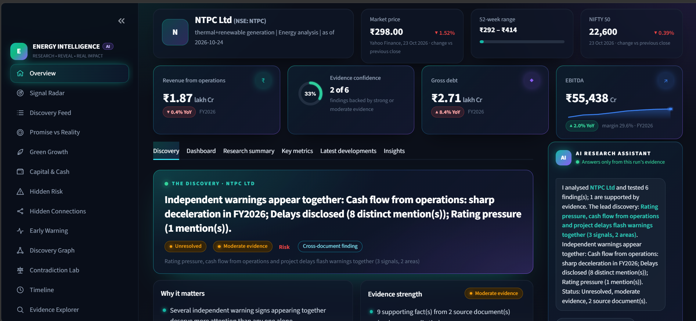
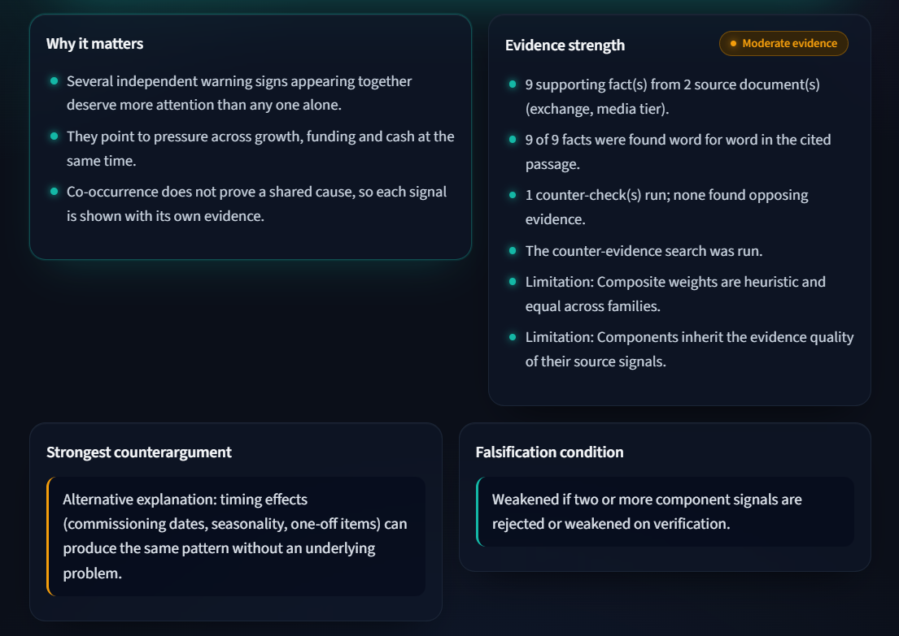
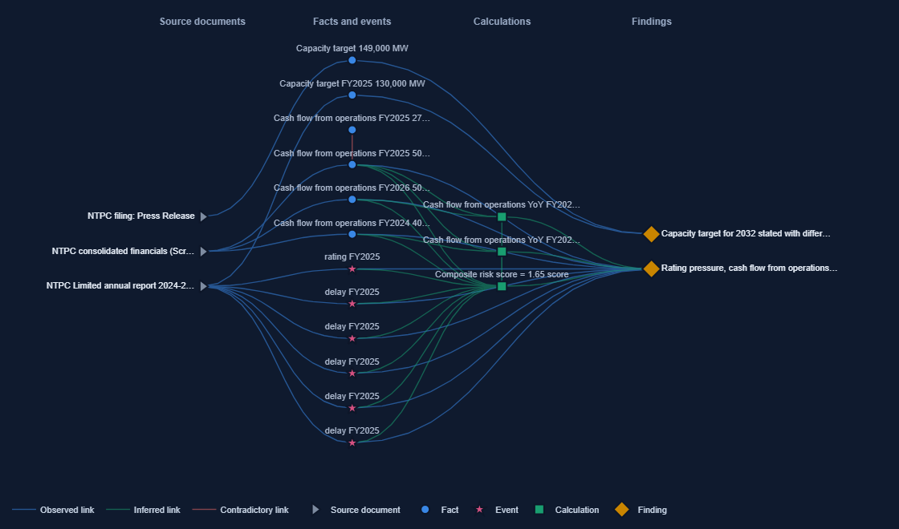

# ⚡ Energy Intelligence Agent

**ATMOS 2026 · Finding the Next Signal · Track B: Energy, Power & Renewables**

An autonomous research agent for listed Indian energy companies. Give it a company name and it reads the
company's public disclosures on its own, connects evidence across documents, calculates what changed, forms
hypotheses, **tries to disprove them**, and shows a graded discovery where every claim clicks through to the
filing, page and passage it came from.

> **For the judges.** Demo video: _[add your video link]_ · Run it in three commands (Python 3.11+):
> `pip install -r requirements.txt` → `streamlit run app.py` → type a company (e.g. **NTPC**) in the search bar.
> No API key is needed. **Demo mode** runs a fictitious company offline in seconds.


<sub>A real run on NTPC (24 Oct 2026): live share price, figures from NSE filings and results tables, the discovery
with its status and evidence grade, and an assistant that answers only from the run's evidence.</sub>

---

## Why it exists

A listed energy company tells its story across documents: the capacity target in an investor presentation,
the commissioning in a one-line exchange filing, the borrowing in the annual report notes, the profit in a
results table, a rating change in a rationale. Read one at a time, every line looks fine. **The signal is in
the gaps between them**: a target that needs several times the historical build pace, commissioning that never
shows up in reported capacity, revenue growing on price rather than volume, debt outrunning earnings.

A summariser repeats each document and a dashboard plots each number. This agent looks for the gaps, treats
each one as a hypothesis, and attacks it before showing it to anyone.

## What it produces

For every discovery, the eight elements the brief asks for:

| Element | How the agent produces it |
|---|---|
| **The Discovery** | One sentence, chosen from findings backed by **two or more independent documents** |
| **Why it matters** | Three to five bullets specific to the finding type |
| **Evidence** | Every supporting fact with its document, page, verbatim passage and link |
| **Timeline** | When the change first became visible, how it developed, and the sharpest move between periods |
| **Numbers** | Only the calculations that substantiate the finding, each with formula and inputs |
| **Counterargument** | The strongest alternative explanation, including a sector-peer test |
| **Falsification condition** | What future evidence would weaken or reject the finding |
| **Evidence strength** | Strong / Moderate / Weak / Insufficient, with the reasons listed |



## How it works

```
company name / NSE symbol
  → 01 RESOLVE      identity + business type from data/companies.csv (identity metadata only, no findings)
  → 02 COLLECT      NSE annual reports and filings, results tables, market prices, 2–3 listed peers
  → 03 EXTRACT      facts from tables, sentences and events; units, scope and Indian fiscal periods normalised;
                    each fact keeps its exact passage and page
  → 04 GUARD        plausibility checks hold out figures it cannot trust, with the reason
  → 05 ANALYSE      six modules measure the gaps (deterministic Python, never an LLM)
  → 06 HYPOTHESISE  each signal becomes a testable finding with its own falsification test
  → 07 CHALLENGE    counter-checks, targeted counter-evidence search (rounds 2–3), sector-peer test
  → 08 PROVE        graded discovery, dashboard, report and evidence-only assistant
```

Up to three research rounds. Public sources only, no API key needed, and a failing source is logged and skipped,
never fatal.

### Six modules, one per Track B question

| Module | Question it answers | What it calculates |
|---|---|---|
| Promise vs Reality | Do announced additions differ from what is commissioned? | Target vs actual, required vs historical build pace, capex step-up |
| Green Growth | Has the mix shifted earlier or further than the story? | Capacity, generation and revenue growth; price-led vs volume-led growth |
| Capital & Cash | Is a financing story hidden in the filings? | Leverage, interest coverage, cash conversion, debt vs EBITDA growth |
| Hidden Risk | Are separate warnings appearing together? | Composite of independent signals, receivable days, delays, rating pressure |
| Hidden Connections | Do announcements and reported numbers agree? | Commissioning vs reported capacity, co-movement (never causation) |
| Early Warning | Is a turn already visible in the quarters? | Reversals, slowdowns, same-quarter YoY, margin compression |

Units understood: MW and MU · circuit-km and MVA · Mtoe, BCM and million tonnes · ₹ crore, lakh and million.

### Self-falsification and verdicts

Every finding is attacked three ways (its own counter-checks, a targeted search for contrary evidence, and a
peer comparison that separates a company story from a sector story), then lands on a strict scale:

| Status | Meaning |
|---|---|
| **Supported** | Moderate or strong evidence, counter-search done, nothing material against it |
| **Unresolved** | Tested but not settled: conflicting, thin or one-period evidence |
| **Weakened** | Opposing evidence of weight ≥ 0.4 |
| **Rejected** | Opposing evidence of weight ≥ 0.8 |
| **Insufficient evidence** | Not enough data to test it; said plainly |

A fact is marked *verified* only if its number appears word for word in the cited passage. Calculations are
deterministic and linked to their input facts. The optional LLM never supplies numbers.

### Evidence it refuses to use

Annual reports quote many numbers that are not the company's own. The guard stage and the modules hold these out
and list the reason, rather than building a finding on them. Real examples from the 20-company test run:

| The report says | The agent's call |
|---|---|
| "500 GW of non-fossil capacity by 2030" | India's national goal, not the company's target |
| "A record 700 GW of renewable capacity was added" | A global statistic, above any Indian company's scale |
| "5,051 MW … added in FY 2025-26" | Capacity added in the year, not the capacity level |
| "Water consumed / total generation (kWh) 0.0001" | An intensity ratio, not generation |
| Generation too small for the company's revenue | One plant, not the whole company |

Other generic guards: a value 5× off its neighbouring years from a single source, periods that have not ended yet,
consolidated vs standalone mixes, renewable capacity above total capacity, and growth that is not meaningful from
a tiny or mismatched base.

### Works for any listed energy company

No company names appear in the analysis code (a test fails the build if one does). The agent adapts by
**business type**, read from the registry segment:

| Business type | What changes |
|---|---|
| Power producer | Capacity, generation, utilisation and build-pace checks |
| Grid / transmission | Circuit-km and MVA, network targets |
| Oil & gas | Mtoe, BCM, refinery throughput; power figures treated as a side portfolio |
| Coal / lignite | Production and offtake in million tonnes |
| Lender | No leverage warnings (borrowing is its business); no power assets |
| Manufacturer / EPC | GW figures are factory or order-book capacity, not generation assets |

## The dashboard



| Page | What it shows |
|---|---|
| **Overview** | KPI cards, the Discovery brief, Dashboard / Research summary / Key metrics / Developments / Insights tabs, and the AI research assistant |
| **Signal Radar** | Start live research, upload documents or paste links, watch the research log |
| **Discovery Feed** | Every finding ranked, filterable, each with its Evidence Passport |
| **Six module pages** | Charts, tables, findings, calculations and the figures held out with reasons |
| **Discovery Graph** | How sources, facts, calculations and findings connect; contradictions in red |
| **Contradiction Lab** | Where sources disagree, and the evidence for and against each finding |
| **Timeline** | Targets → milestones → financing → operating and financial results |
| **Evidence Explorer** | Every fact with its passage, page and source; built-in document reader with highlights |
| **Report Studio** | Markdown / HTML research note and facts as CSV |

**AI research assistant.** Ask "What are the main risks?" or "How is debt moving?" and it answers by quoting the
run's own findings and figures with their verification status. It uses no language model, so it cannot invent a
number; if nothing in the run matches, it says so.

## Quick start

**Windows (double-click):**

| File | What it does |
|---|---|
| `setup.bat` | Finds Python, creates `.venv`, installs requirements (repairs a broken venv) |
| `run_app.bat` | Starts the dashboard |
| `dry_run.bat` | Live rehearsal on the 5 NIFTY 50 Track B companies; `dry_run.bat --all` runs every energy company; `dry_run.bat IOC TATAPOWER` runs named ones |
| `dry_run_core.bat` | Live rehearsal on 20 large listed energy companies (~15 min) |

**Any OS:**

```bash
pip install -r requirements.txt
cp .env.example .env            # optional: live research works without any key
streamlit run app.py            # opens the dashboard
python -m pytest                # 205 tests, no network needed
python scripts/dry_run.py --core   # live rehearsal; writes dry_run/<date>/report.md and a diagnostic zip
```

### Configuration (`.env`, all optional)

| Purpose | Variable |
|---|---|
| Key-free primary sources (default on) | `EIA_DIRECT_SOURCES=on`: NSE annual reports and filings, results tables |
| Extra web discovery | `EIA_SEARCH_PROVIDER` = `tavily` · `serper` · `brave` · `anthropic` · `duckduckgo` · `none` (+ matching key) |
| Optional LLM (planning, labelled interpretation; never numbers) | `EIA_LLM_PROVIDER` = `anthropic` · `openai` · `none` (+ key) |
| Market data on the dashboard | `EIA_MARKET_DATA` (set `none` to switch off) |
| Peers / bounds | `EIA_PEERS` (default 3), `EIA_MAX_ROUNDS` (default 3), `EIA_MAX_PDF_PAGES` |

**Demo mode** runs *Aurora Grid Renewables Ltd*, a fictitious company with synthetic documents, through the
identical pipeline. Every demo page carries a synthetic-data banner; demo data never reaches live research.

## Validation

- **205 offline tests**: extraction, periods and units, plausibility guards, every module, verification rules,
  UI smoke tests, and stress tests (all sources failing, corrupt PDFs, random text).
- **7 live dry runs** on 5–20 companies, each followed by generic fixes (never per company) and a re-run.
- **20/20 listed energy companies** run live end to end in about 30–50 seconds each: NTPC, Power Grid, ONGC,
  Coal India, Reliance, IOC, BPCL, HPCL, GAIL, Oil India, NHPC, SJVN, Tata Power, Adani Green, Adani Power,
  JSW Energy, Torrent Power, NLC India, Petronet LNG and PFC.
- **Blind tests on unseen companies** with the code frozen: the first failed, the second was partial, and after
  generic fixes the third passed. See [`validation/README.md`](validation/README.md).

Every dry run exports what each chart shows (`series.csv`: value, source, page, passage) so any figure can be
audited afterwards.

## Project layout

```
app.py                  Streamlit dashboard          ui/theme.py         design system, charts
eia/agent.py            research loop                eia/verification.py hypotheses, counter-checks, grading
eia/extraction/         parsing and rule extraction  eia/modules/        six analytical modules
eia/calculations.py     deterministic calculations   eia/sanity.py       scale plausibility checks
eia/business.py         business-type rules          eia/peers.py        sector-peer comparison
eia/discovery.py        the Discovery brief          eia/assistant.py    evidence-only research assistant
eia/report.py  views.py  graph.py  db.py  schema.py  metrics.py  periods.py  identity.py  providers/
scripts/                research CLI, dry runs, diagnostics
tests/                  205 offline tests            validation/         real-document validation record
data/companies.csv      identity registry (names, symbols, segments; no findings)
```

## Known limitations

- **Scanned annual reports** (no text layer) are logged as unreadable; the agent works from filings and tables.
- **Figures only in prose.** Capacity and generation are often written in sentences rather than tables; the
  guards are conservative, so some genuine operating figures are held out rather than risk a wrong one.
- **One quarter is a short base.** Quarterly moves carry that limitation and rarely reach *Supported* alone.
- Thresholds such as 5× leverage, 2× coverage and 1.5× build pace are sector heuristics, documented in each module.
- The agent gives **no investment recommendation**; findings are hypotheses graded by evidence.

## Team

[Team Name] · ATMOS 2026, BITS Pilani Hyderabad Campus
